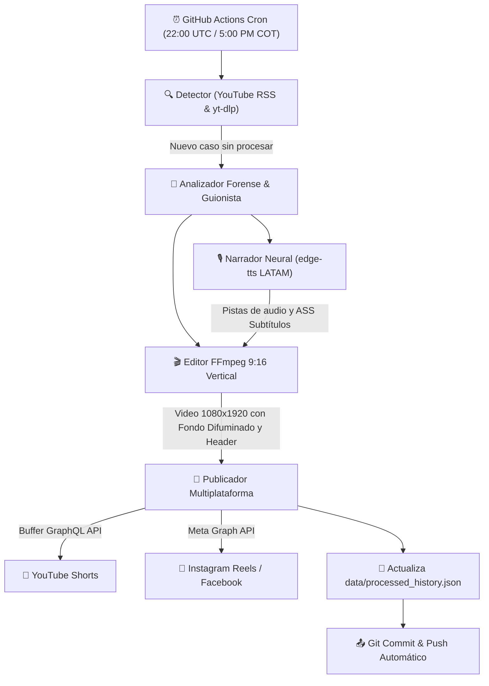

# 🚔 Expediente Policial Bot — Automated Cloud Video Pipeline

Sistema totalmente autónomo de creación, edición y publicación de **YouTube Shorts** y **Reels/TikTok** basado en **GitHub Actions**.

Diseñado para ejecutarse 100% en la nube mediante un **cron job diario**, sin necesidad de tener el computador encendido.

---

## ⚙️ Arquitectura del Sistema

---

## 🎨 Especificaciones Visuales de Edición

- **Lienzo Vertical:** `1080 x 1920` (9:16)
- **Fondo Dinámico:** Video de acción escalado y con desenfoque de movimiento cinemático (`scale=270:480,boxblur=10:2,scale=1080:1920`).
- **Ventana de Acción:** `1080 x 608` centrada en `y=656` con marco perimetral rojo de 2px (`#E52521`).
- **Banner Superior (HUD Card):** Cápsula semitransparente con punto REC parpadeante, agencia policial y titular en tipografía `Impact` amarilla.
- **Subtítulos ASS con Safe-Zone:** Ubicados en `MarginV=390` para no tapar los títulos ni los botones de interacción de Shorts y Reels.

---

## 🔐 Configuración de Secretos en GitHub

En tu repositorio de GitHub, ve a **Settings > Secrets and variables > Actions** y asegúrate de tener:

| Secreto | Descripción | Estado Actual |
| :--- | :--- | :--- |
| `BUFFER_TOKEN` | Token de acceso a la API GraphQL de Buffer | ✅ Configurado |
| `BUFFER_CHANNEL_ID` | ID del canal de YouTube en Buffer | ✅ Configurado |
| `GEMINI_API_KEY` | *(Opcional)* API key de Google Gemini para guiones IA | Opcional |
| `META_ACCESS_TOKEN` | *(Opcional)* Token de la API de Meta Graph para Instagram/Facebook | Opcional |
| `INSTAGRAM_ACCOUNT_ID` | *(Opcional)* ID de cuenta profesional de Instagram | Opcional |
| `FB_PAGE_ID` | *(Opcional)* ID de página de Facebook | Opcional |

---

## 🚀 Ejecución Manual

Además del cron automático programado a las 5:00 PM (hora Colombia), puedes forzar una ejecución en cualquier momento:
1. Ve a la pestaña **Actions** en tu repositorio de GitHub.
2. Selecciona **Expediente Policial Daily Pipeline** en la barra lateral izquierda.
3. Haz clic en **Run workflow**.
